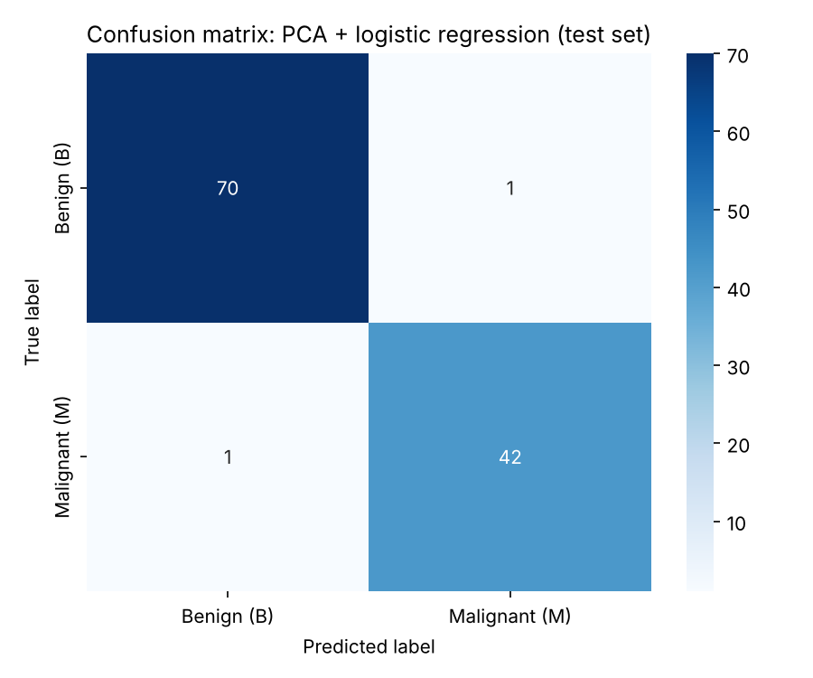
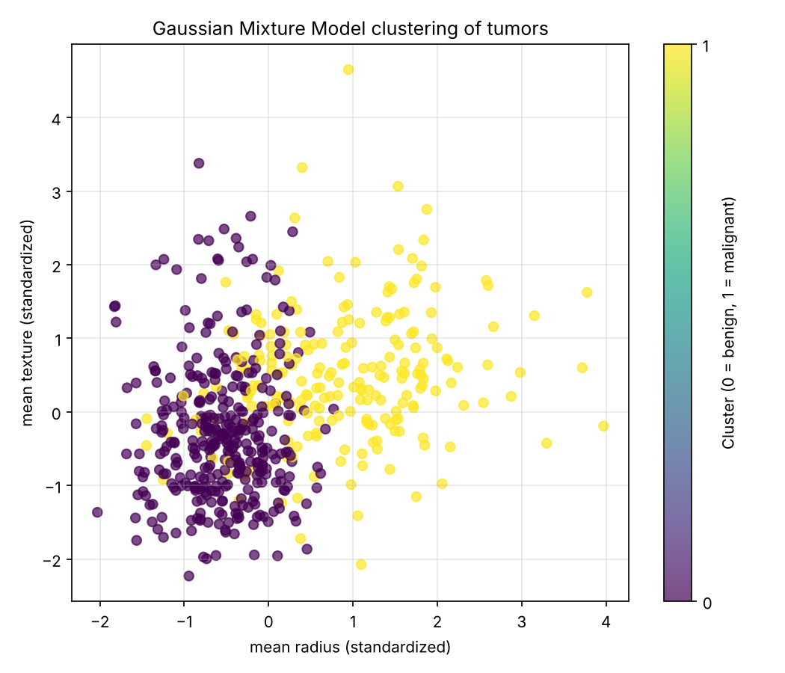

# Breast Cancer Diagnosis from Fine-Needle Aspiration Features

Supervised and unsupervised machine learning to classify breast masses as **malignant or benign** from cell-nucleus features measured in digitized fine-needle aspiration (FNA) images.

> **Context:** Individual final project for *BENG 133 Numerical Analysis & Computational Engineering*, Department of Bioengineering, UC San Diego, Fall 2024.

---

## Motivation

After a suspicious finding in a breast exam or mammogram, FNA is used to decide whether a tumor is malignant. The sample is traditionally assessed by a pathologist under the microscope, so the result depends on expertise and takes time. A false negative at this stage is especially dangerous. Machine learning can provide a fast, consistent second opinion based on quantitative features of the cell nuclei.

## Data

[Wisconsin Diagnostic Breast Cancer (WDBC)](https://archive.ics.uci.edu/dataset/17/breast+cancer+wisconsin+diagnostic): **569 samples** (357 benign, 212 malignant), each with **30 features** computed from a digitized FNA image. Ten nucleus properties (radius, texture, perimeter, area, smoothness, compactness, concavity, concave points, symmetry, fractal dimension) are each summarized as a mean, a standard error and a "worst" (largest) value.

The scripts use `data/data.csv` if you place the original CSV there. Otherwise they load the identical copy bundled with scikit-learn, so no download is needed.

## Models

### 1. Supervised: PCA + logistic regression (`src/supervised_pca_logreg.py`)
1. 80 / 20 train–test split (stratification not used; `random_state = 42`)
2. Standardization (zero mean, unit variance), **fitted on the training set only**
3. PCA keeping **10 components**, which explain 95.1 % of the variance (also fitted on the training set only)
4. Logistic regression (`max_iter = 1000`)

### 2. Unsupervised: Gaussian Mixture Model (`src/unsupervised_gmm.py`)
1. Standardization of all 30 features
2. GMM with **2 components**; the true labels are not used for clustering
3. Each cluster is mapped to the majority true diagnosis in it (for evaluation only)
4. **k-means** baseline for comparison

## Results

| Model | Evaluation set | Accuracy | False positives | False negatives |
|---|---|---|---|---|
| PCA + logistic regression | Held-out test set (114 samples) | **98.2 %** | 1 | 1 |
| Gaussian Mixture Model | All samples (569), unsupervised | **94.0 %** | 18 | 16 |
| k-means (baseline) | All samples (569), unsupervised | 90.5 % | — | — |

For the supervised model, malignant recall is 0.98: 42 of 43 malignant tumors in the test set were detected.

| Supervised: confusion matrix | Unsupervised: GMM clusters |
|---|---|
|  |  |

## Discussion and next steps
- PCA followed by logistic regression is a strong, simple combination for this problem. The GMM recovers the benign/malignant structure without labels at 94 %, clearly better than k-means, which suits the elliptical, unequal-variance shape of the two groups.
- **Next steps:** stratified cross-validation instead of a single split; hyperparameter tuning (e.g. regularization strength); benchmarking against random forests, SVMs and gradient boosting; reporting F1 and ROC-AUC; choosing the number of components by BIC/AIC; and, because false negatives are the costly error, tuning the decision threshold for higher sensitivity.

## Usage

```bash
pip install -r requirements.txt
python src/supervised_pca_logreg.py
python src/unsupervised_gmm.py
```
Figures are saved to `figures/`.

## Notes on this version
Cleaned up in 2026 from the original project scripts: the dataset now loads automatically, figures are saved to files, the k-means baseline mentioned in the report was added as code, and comments and labels were tidied. The models, parameters and results are unchanged.

## Author
**Ignacio Romero Fragoso**, Biomedical Systems Engineer (UNAM). Exchange student at UC San Diego, Fall 2024.
